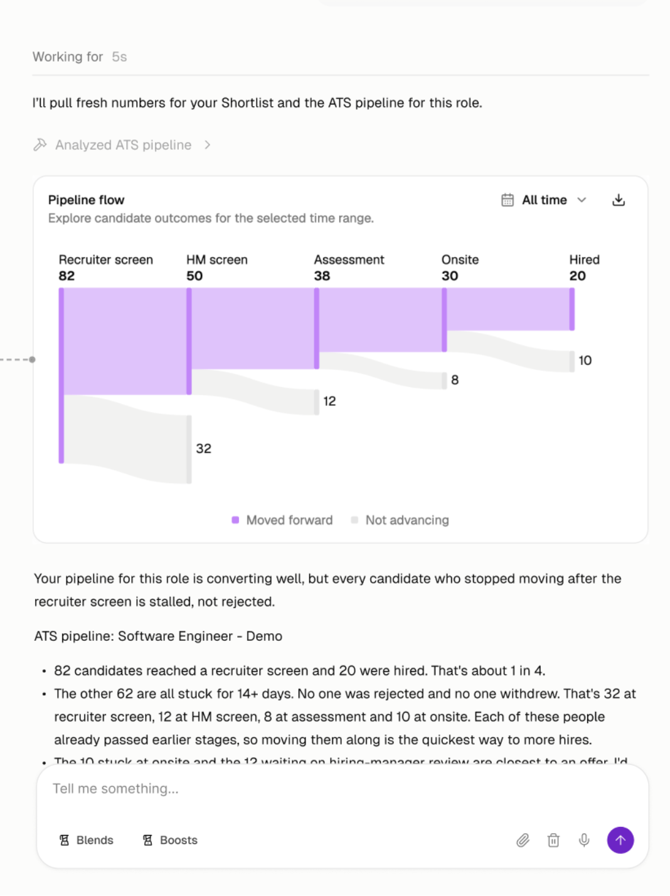

Source smarter by bringing all of your hiring data into your Agent. ATS Intelligence connects your Agent to your Ashby or Greenhouse data. You can see the full picture of every req and use what's happening in your interviews to sharpen how you search.

<Frame>
  
</Frame>

## Why use ATS Intelligence

Your ATS holds invaluable information on each of your roles: who's advancing, who's stuck, what interviewers think, and why candidates fall off. ATS Intelligence puts that in your Agent's hands, so you can:

- **Stay on top of every req** by asking your Agent where candidates are stuck and what to fix, without pulling a report.
- **Show up to every hiring manager sync** with answers on pipeline status, interview feedback, and drop-off.
- **Source from what's working** by seeing which profiles move forward and which fall off, then carrying that into your search.

<Info>
  ATS Intelligence is available on the Business plan and requires Ashby or Greenhouse to be connected to Juicebox.
</Info>

## What your Agent can read

| Data | Examples | Who can see it by default |
| --- | --- | --- |
| Jobs and applications | Open roles, applicants, sources, hires | Everyone |
| Stages and stage history | Current stage, every stage move with timestamps, time in stage | Everyone |
| Interviews | Interview stages, interviewers, schedules | Everyone |
| Interview feedback and scorecards | Ratings, written feedback, recommendations | Role collaborators |
| Rejection reasons | Why candidates were rejected or withdrew | Role collaborators |
| Offer details | Offer status, sent and closed dates, start date. No compensation data. | Role collaborators |
| Candidate emails | Synced email threads with candidates | Role collaborators |

Your Agent also adds Juicebox profile data, like work history, schools, past companies, skills, and more, to your ATS candidates.

## What you can ask

Start with the [ATS pipeline health Blend](/agents/blends), or ask your Agent in your own words. Here are some ideas by topic.

### Pipeline and bottlenecks

- "How's my pipeline looking for this role?"
- "How long have candidates been waiting in their current stage?"
- "Which candidates are waiting on hiring manager review?"

### Drop-off and rejections

- "Where are candidates dropping off for this role?"
- "What are the most common rejection reasons for this role?"
- "What's the pass-through rate from phone screen to onsite?"

### Interview feedback

- "Summarize the interview feedback for candidates who made it to the final round."
- "What do interviewers say about candidates who don't move forward?"

### Sourcing from what's working

- "Find more candidates like the ones who made it past the onsite."
- "Target the past companies that show up most among candidates who got offers."
- "Update my Agent's criteria based on who's moving forward in the pipeline."

## Sensitive data and permissions

Interview feedback, scorecards, rejection reasons, offer details, and candidate emails are visible only to role collaborators by default.

- **Who can see restricted data:** Only users who are collaborators on that role, in Juicebox or in your ATS. Everyone else gets answers without restricted fields.
- **What offer details include:** An offer's status and dates. Offer details don't include compensation data, such as salary, bonus, or equity.
- **Changing the defaults:** Admins can choose which fields are restricted in **Settings > Integrations**.
- **How your data is used:** Your ATS data stays within your organization. Juicebox does not use customer data for its candidate or profile database in any way.

## Turning on ATS Intelligence

<Tabs>
  <Tab title="Greenhouse">
    <Steps>
      <Step title="Open the Greenhouse integration">
        A Juicebox admin goes to **Settings > Integrations** and selects **Greenhouse**. You may also see a banner asking you to reconnect.
      </Step>
      <Step title="Reauthorize Greenhouse">
        Follow the authorization flow, the same one you used to connect Greenhouse the first time. See the [Greenhouse setup guide](/help/ats-setup/greenhouse#setting-up-the-integration-on-greenhouse) for each step.
      </Step>
      <Step title="Approve the new permissions">
        Approve the additional permissions. That's it.
      </Step>
    </Steps>
  </Tab>
  <Tab title="Ashby">
    <Steps>
      <Step title="Open your Ashby API credentials">
        An Ashby admin opens Ashby and goes to **Admin > Integrations > API Credentials**.
      </Step>
      <Step title="Edit the Juicebox API key">
        Edit the API key used for Juicebox.
      </Step>
      <Step title="Turn on the additional permissions">
        Turn on the additional permissions listed in the [Ashby setup guide](/integrations/ashby), including note-taker, emails, and feedback forms, then save.
      </Step>
      <Step title="Check again in Juicebox">
        In Juicebox, return to the Ashby permissions modal and select **Check again**.
      </Step>
    </Steps>
  </Tab>
</Tabs>

<Note>
  Data can take up to 10 minutes to sync after you update permissions. Need help? Reach out to support or your CSM.
</Note>
