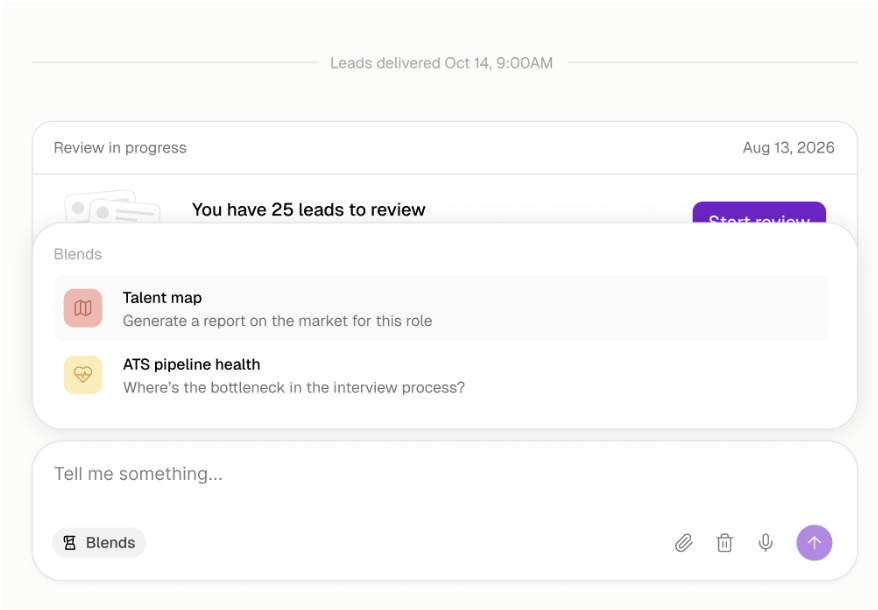

Run your Agent's most useful workflows in one click. Blends are ready-made prompts that help you stay on top of every req, from mapping your market at kickoff to checking on your pipeline.

<Frame>
  
</Frame>

## What are Blends?

Blends are one-click actions in your Agent. Each one starts from a proven prompt, so you don't have to work out what to ask. You can run it as is, add your own context, or skip the Blend entirely and ask in your own words.

- **Faster starts:** Select a Blend instead of writing a prompt from scratch.
- **Customizable:** Every Blend opens as a prompt you can enrich with additional context or direction before it runs.
- **Repeatable:** Run the same Blend on every role, so every search starts with the same strategic prep.

## Running a Blend

<Steps>
  <Step title="Open your Agent">
    Open the Agent for the role you're working on.
  </Step>
  <Step title="Open the Blends menu">
    Select **Blends** at the bottom of the chat box, or type `/` in the chat.
  </Step>
  <Step title="Select a Blend">
    Select a Blend from the menu. Its prompt appears in the chat box.
  </Step>
  <Step title="Add context (optional)">
    Edit the prompt if you want to add context, like a location, a level, or what your hiring manager asked for.
  </Step>
  <Step title="Run it">
    Press **Enter** to run it. Your Agent replies in the chat, and longer answers open as a report you can share.
  </Step>
</Steps>

<Tip>
  Blends use your Agent's context, including the job description, intake notes, and calibration. The more context your Agent has, the sharper the result.
</Tip>

## Available Blends

| Blend | What it does |
| --- | --- |
| **Talent map** _"Generate a report on the market for this role"_ | Builds a shareable report on the market for the role: how many people fit, where they're located, top employers, titles, adjacent titles, years of experience, and skills. |
| **ATS pipeline health** _"Where's the bottleneck in the interview process?"_ | Visualizes where candidates are stuck, why they drop off, and what to fix, using your ATS data. |

## Tips for getting more out of Blends

- **Run Talent map before your intake:** Bring the report to your hiring manager kickoff so you scope the role from the same data.
- **Check ATS pipeline health before every hiring manager sync:** You'll walk in knowing where candidates are stuck and what to do next.
- **Follow up in the chat:** After a Blend runs, keep asking. Try "Which of these companies should I target first?" or "Who's been waiting longest for a decision?"
- **Share the report:** Talent map reports open in a shareable view you can send to your hiring manager.

<Note>
  More Blends are on the way. New Blends appear in the menu automatically, with no setup needed.
</Note>
