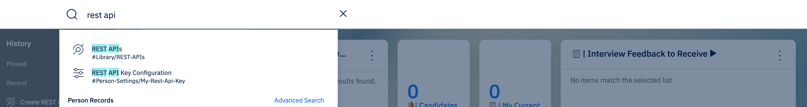
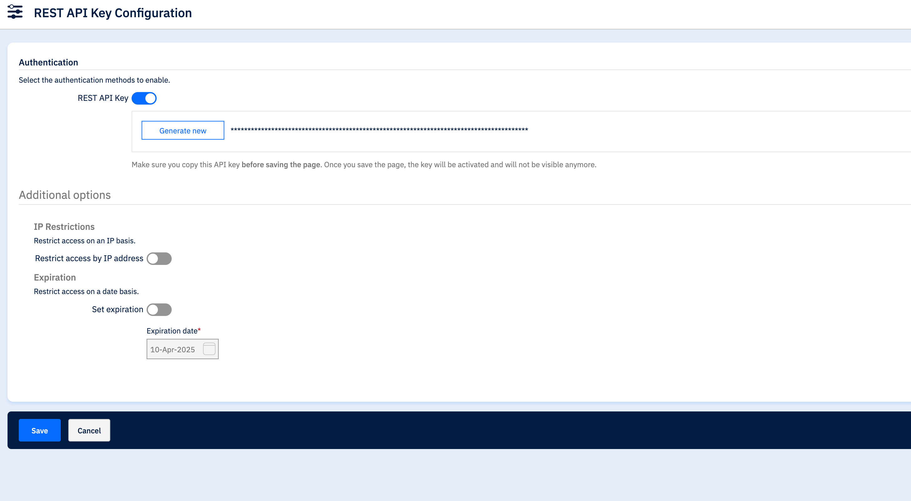
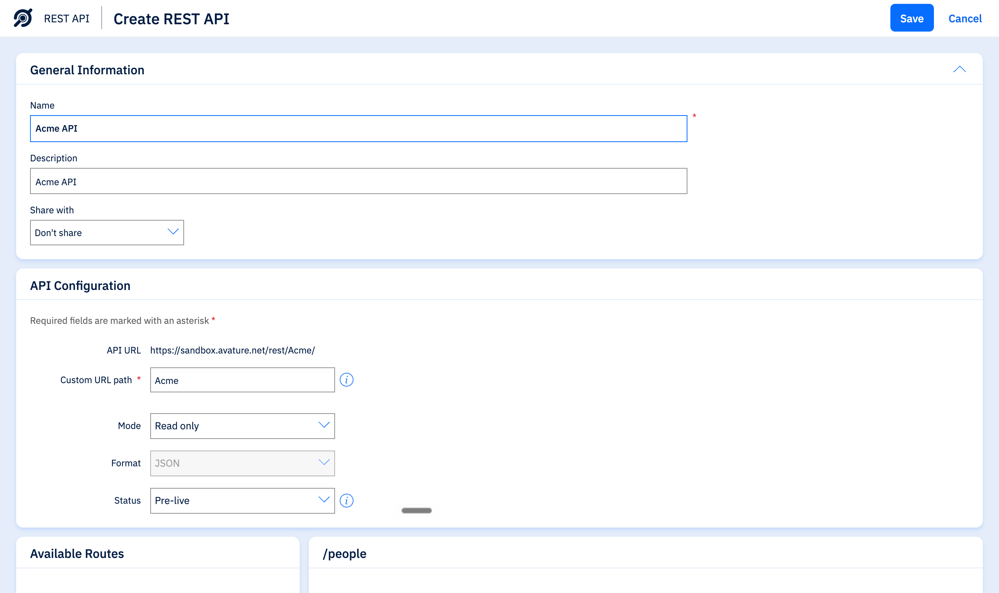
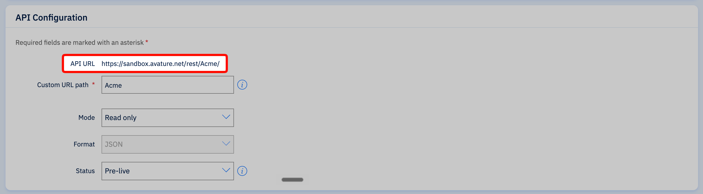
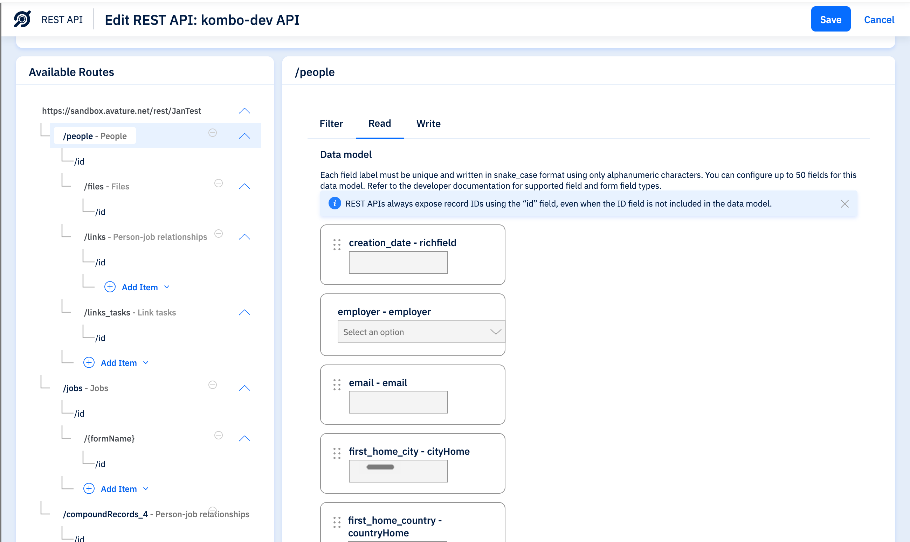
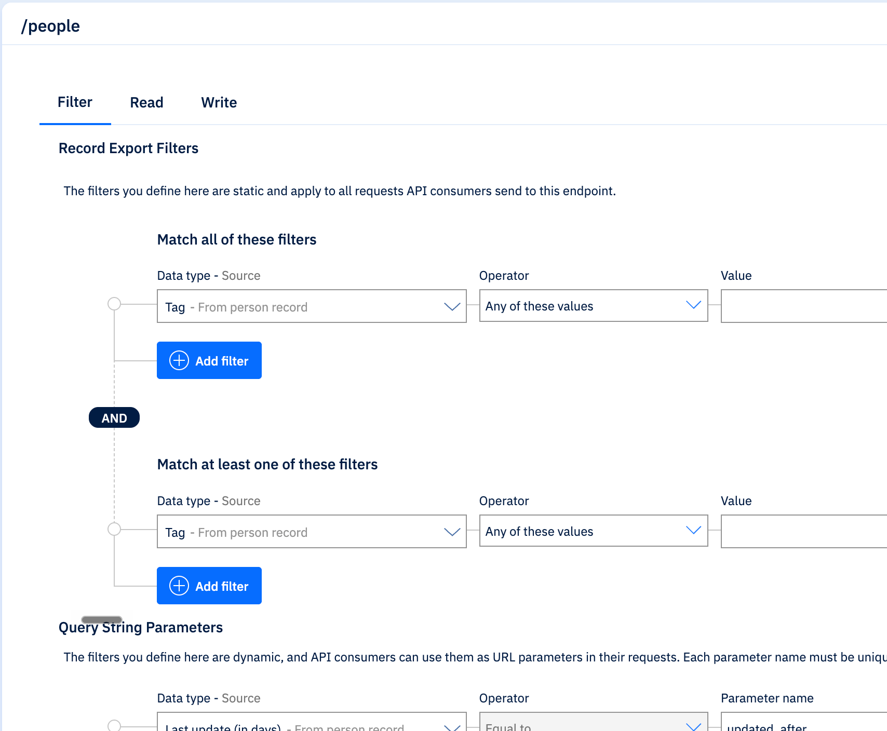
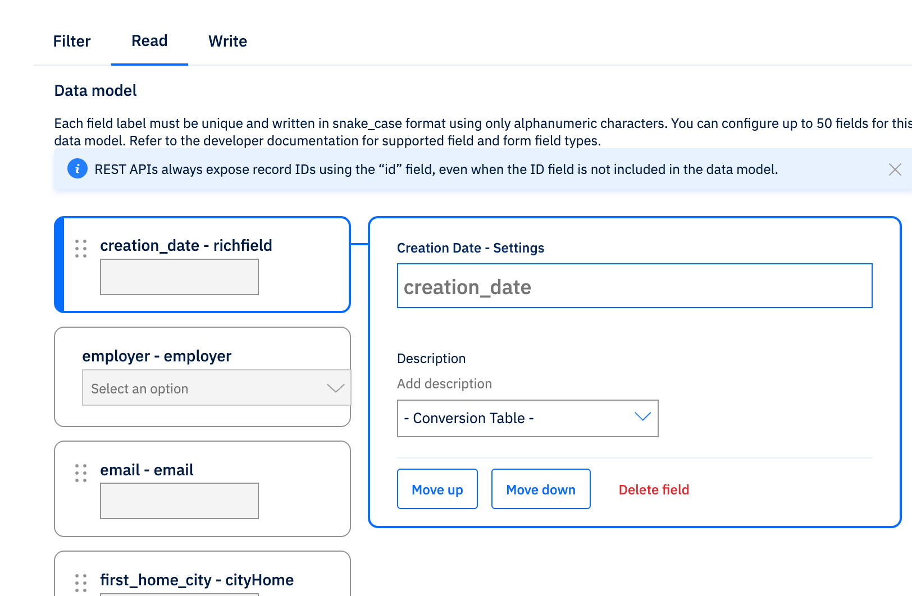
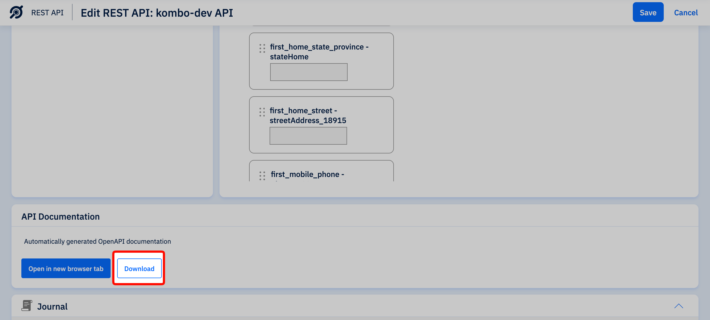

## About the integration

Connect Avature to Juicebox to import job descriptions into your searches and identify profiles that already exist in your ATS.

You can also export profiles to a selected Avature job.

<Note>
Avature is available through assisted onboarding on eligible Juicebox plans. Contact your Juicebox account team before starting setup.
</Note>

## Before you start

*Estimated setup time: 45–60 minutes.*

You must be an Avature administrator to complete the setup.

1. Sign in to Avature and search for **REST API**.
2. Check that **REST APIs** and **REST API Key Configuration** appear in the results. If they do not, you are not an admin. Ask your Avature administrator to give your account the required permissions or to complete the setup.
3. Open **REST APIs** and check that at least one REST API is available. If none are available, contact Avature support to enable one. Avature charges for each REST API, so this can take a few days.

<Frame caption="Both menu items appear when you search for REST API as an admin.">
  
</Frame>

Open **Integrations** in Juicebox, select **Avature**, and choose **Activate**. Keep the connection window open while completing the steps below. If the integration is not visible, ask [Juicebox Support](mailto:support@juicebox.ai) to confirm access for your account.

The setup has three main steps:

1. Generate a REST API key.
2. Create a custom REST API and configure its endpoints, filters, and fields.
3. Download the API documentation and upload it to the connection window.

Some steps depend on the data requested for your connection. If a step does not appear in your connection window, skip it.

<Note>
The screenshots show vendor settings or the connection window provided by Kombo. Use the names, paths, fields, and URLs from your own connection; screenshot values are examples.
</Note>

## Generate the API key

1. In Avature, search for **REST API Key Configuration** and open the page.
2. Turn on the **REST API Key** toggle and click **Generate new**.
3. **Expiration:** do not set an expiration date. If the key expires, the integration stops syncing until it is reconnected with a new key.
4. **IP restrictions:** leave this empty. If you want to allowlist static IPs, contact [Juicebox Support](mailto:support@juicebox.ai) first.
5. Copy the key and paste it into the connection window.
6. Click the blue **Save** button in the bottom-left corner.

<Frame caption="Copy the key before saving. Avature hides it after the page is saved.">
  
</Frame>

<Warning>
**Already have a key?** Generating a new key replaces the current one, and any other tool using it stops working. Check with your team first. If a key is already in use, you can paste that key instead.
</Warning>

## Create the REST API

Create the custom REST API that Juicebox connects to. The remaining steps add endpoints and fields to this API.

### Create the API

1. On the **REST APIs** page, click **Create** in the top-right corner.
2. Under **General Information**, enter:
   - **Name** and **Description**: the value shown in the connection window. This helps your team recognize what the API is for.
   - **Share with**: *Don't share*. This stops other Avature users from editing the API and breaking the integration by accident.

<Frame caption="General Information and API Configuration for a new REST API.">
  
</Frame>

### Configure the API

1. **Mode**: select the mode shown in the connection window.
   - *Read only*: data is only read from Avature.
   - *Read and write*: candidates and applications are also created in Avature.
2. **Format**: *JSON*.
3. **Status**: *Pre-live*.
4. **Custom URL path**: copy the value from the connection window and paste it exactly as shown.

### Copy the full API URL

Avature builds the full **API URL** from your domain and the custom URL path. Copy it and paste it into the **Full API URL** field in the connection window.

<Frame caption="The full API URL appears above the Custom URL path field.">
  
</Frame>

## Configure the endpoints

Add the routes, filters, and fields the connection needs. Which ones you need depends on the data requested for your connection, so **follow the lists shown in the connection window**.

All of these actions happen in the **Available Routes** section. Routes are shown as a tree under your API URL, for example **/people People** or **/jobs Jobs**.

### Add a route

Routes are the endpoints that are read from and written to, for example candidates, jobs, or candidate files.

1. In **Available Routes**, find where the connection window says to add the route:
   - **Directly under your API URL** for a main route, such as **Jobs**.
   - **Under an existing route** for a sub-route, such as **Files** under **/people People**.
2. Click **Add Item** at that spot.
3. Select the route named in the connection window.

<Frame caption="Routes appear as a tree under your API URL.">
  
</Frame>

### Add a filter

Filters let the integration fetch only records that changed, instead of downloading all your data on every sync.

1. In **Available Routes**, click the route named in the connection window and open the **Filter** tab.
2. Scroll to **Query String Parameters**.
3. For each filter in the connection window, set:
   - **Data type - Source**: the source shown in the connection window, for example *Last update (in days)*.
   - **Parameter name**: the name shown in the connection window, for example *updated_after*.
4. To add another filter, click the blue **Add filter** button and repeat step 3.

<Frame caption="Query String Parameters are at the bottom of the Filter tab.">
  
</Frame>

### Add fields

Fields decide which data can be read (**Read** tab) and written (**Write** tab) on a route.

1. In **Available Routes**, click the route named in the connection window and open the **Read** or **Write** tab, as the connection window says.
2. Under **Data model**, click **Add Item**.
3. Select every field listed in the connection window. Fields are listed alphabetically, as they appear in Avature.
4. Click **>** in the middle to move them over.
5. Click the blue **Add N items** button in the bottom-left corner.

Some fields must use a specific name so they can be recognized, for example *ref_number* or *salary_expectations*:

1. In the route's **Data model**, find the field you added.
2. Change its name to the exact name shown in the connection window.

<Frame caption="Select a field in the data model to rename it.">
  
</Frame>

<Warning>
Enter parameter and field names exactly as shown in the connection window: lowercase, with underscores, and no quotes. If a name is different, the setup check at the end may fail, or the integration may not be able to use that data.
</Warning>

### Optional steps

The connection window may also show these. You can skip them and add them later.

- **Record Export Filters** (on **/jobs**): only sync jobs that match your criteria, for example only active jobs.
- **Screening questions**: show your Avature screening questions to candidates when they apply. You need a form picker field on your jobs first.

## Save the API and upload the documentation

Save your REST API and upload its documentation file. The connection uses this file to check that everything is set up correctly before connecting.

1. Click the blue **Save** button.
2. Open the REST API again from the **REST APIs** page.
3. Scroll to the **API Documentation** section.
4. Click **Download**. This saves a file called *openapi.yaml*.
5. In the connection window, upload the *openapi.yaml* file.
6. Click **Continue**.

<Frame caption="Download the OpenAPI documentation from the API Documentation section.">
  
</Frame>

The file is checked against everything the connection window asked you to set up. If something is missing, you see a list of the items that failed, for example **"First Email field was added to the /people endpoint's read fields"**. After fixing the issue, download a new *openapi.yaml* file and upload it again.

## Troubleshooting

**The API URL in the file does not match the URL given in step 2!**
The URL you entered in the connection window is different from the one in your REST API. Check that the subdomain and the custom URL path match exactly. A trailing slash does not matter. Go back to the **Full API URL** step and correct it.

**We ran into issues parsing your file! Did you upload the correct openapi.yaml file?**
The uploaded file is not the API documentation. Download it again from the **API Documentation** section of your REST API and upload that file unchanged.

## Confirm the integration

Finish the connection window and return to Juicebox. Confirm that the connection has completed, then allow the initial sync to populate your data.

- Check that the expected jobs appear in Juicebox.
- Find a known candidate and confirm that they are recognized as an existing Avature record.
- Export a test profile to a selected job, then verify it in Avature.

<Note>
The initial sync can take time. Data may continue to appear after the connection is established. If you do not see the expected records, contact Juicebox Support.
</Note>

## Limitations

- Exporting candidates to Avature without selecting a job is not currently supported.
- Resume exports and links that open candidates in Avature require additional setup. Confirm these requirements with your Juicebox contact before rolling the integration out to your team.

## Using the integration

To start a search from a job, open [Projects](/projects) and select **Import Job from ATS / CRM**, then choose the relevant Avature job.

Juicebox identifies profiles that already exist in Avature, helping your team check for existing records before reaching out. Learn how to work with existing candidates in [Talent Rediscovery](/talent-rediscovery).

To send a profile to Avature, follow the [export steps](/exports) and choose the Avature export option for the linked job. Confirm that the profile appears in Avature after the export completes.

## Support

For help, contact [support@juicebox.ai](mailto:support@juicebox.ai). For an overview of available workflows, see [ATS Integrations](/ats-integrations).

ATS-side setup reference: [Kombo’s Avature connection guide](https://help.kombo.dev/hc/en-us/articles/51457748977425-Avature-How-do-I-link-my-account).
