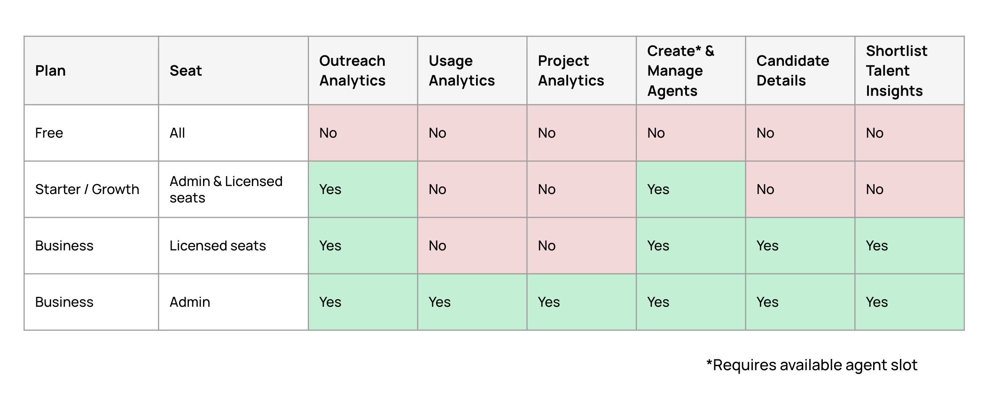
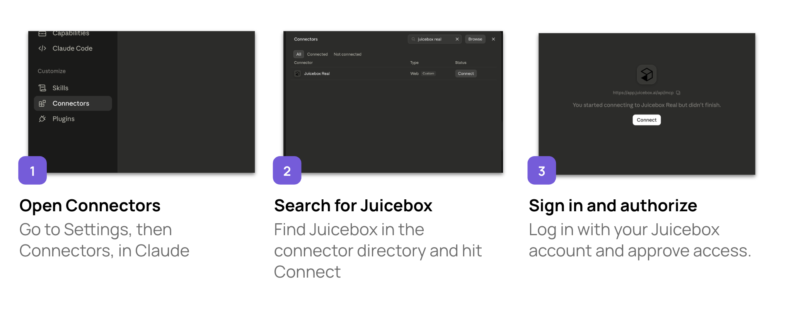
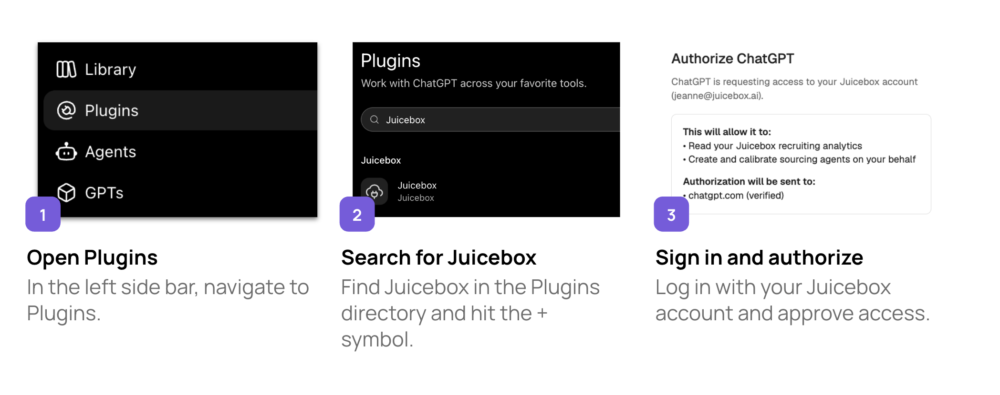

The Juicebox Model Context Protocol (MCP) server lets AI models and agents access and interact with your Juicebox data through a standardized interface.

Connect it to Claude, ChatGPT, Grok Bot, Cursor, or any other MCP-compatible tool to read your recruiting analytics and create or calibrate agents in Juicebox, all without leaving your AI client.

## **Permissions & access**

The Juicebox MCP server is available on all Juicebox paid plans. Access levels vary based on the plan you are on. Please review the access matrix below for more details.

<Frame>
  
</Frame>

## **Authentication**

Our MCP server authenticates each user individually via OAuth. You complete your own OAuth flow during setup, so the server only returns data you can already see in Juicebox. You cannot query projects, searches, or candidates you do not otherwise have access to in the app.

### **Re-authentication every 365 days**

Each MCP connection stays signed in for 365 days from the time you first approve it. Your AI client refreshes access automatically during that window, but refreshing does not extend the session past 365 days. After 365 days, your client prompts you to complete the OAuth flow again. Sign in and select **Approve** to reconnect.

<Note>
  Connections approved before the 365-day lifetime was introduced keep their original 30-day deadline. Reconnect once to get the longer session.
</Note>

If your client's registration with the Juicebox MCP server is missing, the client registers again automatically when you sign in. You don't need to remove and re-add the server.

### **Turn MCP access on or off for your organization**

Admins can control whether members of the organization can use the Juicebox MCP server. MCP access is on by default.

1. In Juicebox, go to **Settings \> Organization**.
2. Find the **Juicebox MCP** section.
3. Turn **Allow MCP access** on or off.

When MCP access is off, Juicebox refuses new connections and requests from every assistant that is already connected. Existing connections are not deleted. When you turn MCP access back on, connected assistants resume working without reconnecting.

<Note>
  Only admins and read-only admins on plans that include MCP access see this setting.
</Note>

### **SSO-enforced organizations**

If your organization requires SSO, Juicebox only accepts MCP connections that you authorized while signed in with SSO. Juicebox refuses connections authorized with a password or Google sign-in, and your AI client can no longer call Juicebox tools or refresh access.

To fix this, sign out of Juicebox, sign back in with SSO, and then reconnect the Juicebox MCP server from your AI client. Select **Approve** when prompted.

<Note>
  Connections approved before this check was introduced keep working until their session ends. After that, you must reconnect while signed in with SSO.
</Note>

## **Set up your MCP client**

The Juicebox MCP server is client-agnostic and works with any MCP-compatible tool.

The server URL is:

[https://mcp.juicebox.ai/v1](https://mcp.juicebox.ai/v1)

_Note: this URL is only used by MCP clients. Opening it directly in a browser will show an error, which is expected._

Select your client below for setup instructions. During setup, you'll see an approval screen listing the permissions the MCP server requests. Select **Approve** to continue.

| Scope | What it allows |
| --- | --- |
| `analytics:read` | Read your Juicebox recruiting analytics |
| `agents:write` | Create and calibrate recruiting agents on your behalf |
| `shortlist:write` | Add candidates to your project shortlists |
| `candidates:write` | Update shortlisted candidates' stages, stars and tags, which can stop their sequences, or remove them from a shortlist |
| `tags:write` | Create, rename, recolor and delete your organization's tags |

<Note>
  Connections approved before the `shortlist:write`, `candidates:write`, and `tags:write` scopes were added don't include them. To use the shortlist, candidate, and tag write tools, disconnect Juicebox in your AI client and connect it again, then select **Approve**.
</Note>

### **Claude Connectors**

1. In Claude, go to **Settings \> Connectors** and search for Juicebox, or go there directly with this link: [claude.ai/directory/connectors](https://claude.ai/directory/connectors/e6d9e323-b594-403d-a431-563f4da6712a)
2. Select **Juicebox** and select **Connect**.
3. You'll be prompted to log in to Juicebox (if you aren't already) and select **Approve** in the MCP access window.

<Frame>
  
</Frame>

Using the Claude CLI (Claude Code)? Add the server with the following command, then complete the OAuth flow when prompted:

claude mcp add --transport http juicebox [https://mcp.juicebox.ai/v1](https://mcp.juicebox.ai/v1)

### **ChatGPT Plugins**

1. In ChatGPT, open **Settings \> Plugins** and search for Juicebox, or use this link: [chatgpt.com/apps?q=Juicebox](https://chatgpt.com/apps?show_chat_button=true&q=Juicebox)
2. Select **Juicebox** and select **Connect**.
3. Follow the authorization prompts to complete setup.

<Frame>
  
</Frame>

### **Grok Bot**

1. Open the Juicebox plugin page in Grok Bot: [x.ai/bot/plugin/52606141](https://x.ai/bot/plugin/52606141). You can also find it from the **Juicebox MCP** section on the Integrations page in Juicebox.
2. Follow the authorization prompts to connect Juicebox.
3. Log in to Juicebox (if you aren't already) and select **Approve** in the MCP access window.

### **Cursor and other IDEs**

1. Open **Cursor Settings \> Tools & MCPs \> New MCP server**.
2. Paste the following into your configuration:

\{

  "mcpServers": \{

    "juicebox": \{

      "url": "[https://mcp.juicebox.ai/v1](https://mcp.juicebox.ai/v1)"

    \}

  \}

\}

3. Save and restart Cursor. When you use a Juicebox tool for the first time, complete the OAuth flow to connect your workspace.

### **Gemini CLI**

Juicebox's MCP server supports dynamic client registration, so you can configure it with Gemini CLI:

1. Add the server with the command: gemini mcp add --transport http juicebox [https://mcp.juicebox.ai/v1/](https://mcp.juicebox.ai/v1/)
2. Complete the auth process. For more on Gemini CLI's auth process, check out [their MCP server guide](https://geminicli.com/docs/tools/mcp-server/#automatic-oauth-discovery).
3. Restart the Gemini CLI (or run /mcp reload if the session is active) and check the status using the built-in command /mcp list. You should see the server listed with a "Connected" status.

### **Tools**

**Analytics tools**

- get\_schema — Shows a catalog of what data you can ask about: the available tables, fields, and example questions. You call this first so you know what you're allowed to query.
- get\_data — Runs a read-only report and returns rows of data (e.g. counts, breakdowns, activity). It's the actual "answer my analytics question" tool, always limited to your organization's data.
- resolve — Turns a human name or link into the internal ID the system needs. You give it a project name, a teammate's name/email, a sequence title, or an agent name (and it hands back the matching ID), so other tools can act on the right thing.

**Shortlist tools**

- search\_shortlist — Lists the candidates saved to a project's shortlist, with optional filters (e.g. by title or school). You can also filter by tag name (`tags`), tag ID (`tagIds`), or whether a candidate is starred (`starred`). Read-only, and only for projects you're allowed to see. Available on the Business plan.
- get\_candidate\_details — Pulls richer details on specific shortlisted candidates that the quick list doesn't include—like total years of experience and job tenure—so you can filter or analyze on those. Available on the Business plan.<br />

**Shortlist and candidate write tools**

These tools change data in Juicebox. Your AI client only calls them when you explicitly ask. Each requires edit access to the project and is available on any paid plan.

- add\_to\_shortlist — Adds people to a project's shortlist. Requires the `shortlist:write` scope. Pass up to 100 contact IDs and rows per call. Each row is either a LinkedIn profile URL or a full name plus current company. A row with a LinkedIn URL is added directly. A name-and-company row is never added on the first call: it returns up to 3 matching people so you can pick the right one, and your client re-sends the row with that person's LinkedIn URL. People who can't be matched come back as not found; add them with the CSV import in Juicebox. If the project auto-exports shortlisted candidates to an ATS, the client asks you to confirm the export first.
- update\_candidates — Changes candidates already on a project's shortlist. Requires the `candidates:write` scope. Pass up to 25 contact IDs per call. You can move candidates to a pipeline stage, star or unstar them, add or remove tags, or remove them from the shortlist. If a stage change would end active outreach sequences, the client asks whether to stop those sequences first. Removing candidates from the shortlist can't be combined with other changes and doesn't stop their sequences. Hiring managers and sequence seats can change stage and star, but can't change tags.
- list\_candidate\_labels — Lists your organization's pipeline stages (in order) and candidate tags, with the names and IDs that update\_candidates, search\_shortlist, and manage\_tags accept. Requires the `analytics:read` or `candidates:write` scope. With only `tags:write`, it returns just the tags.

<Note>
  Changes from add\_to\_shortlist and update\_candidates can take a few seconds to show in search\_shortlist and get\_candidate\_details. If a candidate you just added or changed looks missing or unchanged, wait a few seconds and try again.
</Note>

For example, you can ask your AI client:

```text
Add these three people to the Senior Backend Engineer shortlist, then tag them "Referral" and star them:
https://www.linkedin.com/in/example-one
https://www.linkedin.com/in/example-two
Jane Doe at Acme Corp
```

**Tag tool**

- manage\_tags — Creates, renames, recolors, or deletes one of your organization's tags. Requires the `tags:write` scope. Tags are org-wide, so changes show for everyone. You can't delete a tag while any candidate still has it, and you can't rename or delete mandatory tags such as "Do not contact". If a new name looks like an existing tag, the client asks you to confirm before creating a separate one. Available on any paid plan.

**Project tool**

- get\_project — Gives a summary of one project: its basic info plus how much is in it (number of saved searches and shortlisted candidates). Available on the Business plan.

**Agent tools**

- get\_agent\_schema — Explains how recruiting agents work: what you need to create/configure one, the lifecycle (start, pause, resume, close, reopen), and current limits. You read this first before creating an agent.
- create\_agent — Creates a new automated recruiting agent for a role (or fine-tunes an existing one). If you give it enough about the role, it sets up and starts searching for candidates in one step; if not, it asks a follow-up question.
- start\_sourcing — Tells an already-set-up agent to begin actively searching for candidates. Usually not needed since create\_agent starts automatically, but useful for restarting or retrying.
- manage\_agent — Controls an existing agent's lifecycle: pause, resume, close, or reopen it.

## **Usage limits**

To keep Juicebox fast and reliable, the MCP server limits how much each user can do. When you reach a limit, the tool tells your AI client when it can retry.

- **Tool budget:** Every tool call counts toward a shared budget per user and organization: 120 units per minute, 4,000 per hour, and 40,000 per day. Most tools cost 1 unit. Heavier tools cost more.
- **Per-tool caps:** Some tools also have their own call limits:

| Tool | Per minute | Per hour | Per day |
| --- | --- | --- | --- |
| create\_agent | 15 | 60 | 200 |
| start\_sourcing | 10 | 20 | 40 |
| manage\_agent | 20 | 60 | 200 |
| answer\_product\_question | 20 | 100 | 200 |
| get\_candidate\_details | — | 750 | 1,500 |
| check\_agent\_status | — | 120 | 500 |

- **Tags per call:** update\_candidates accepts at most 10 tags per call, across all tags added and removed.
- **Organization tag limit:** An organization can have at most 50 tags. manage\_tags refuses to create tags past this limit, so delete unused tags first. update\_candidates doesn't create new tags past the limit.
- **Tag-list changes:** Creating, renaming, recoloring, and deleting tags (including tags that update\_candidates creates) is limited to 10 changes per minute and 100 per day per user.

## **Export limits**

To keep Juicebox fast and reliable, some detailed candidate exports through the MCP Server count toward your plan's monthly export limit.

- **Doesn't count toward your limit:** Lightweight lookups like a candidate's name or LinkedIn URL.
- **Counts toward your limit:** Full candidate profiles, including experience history and contact details.
